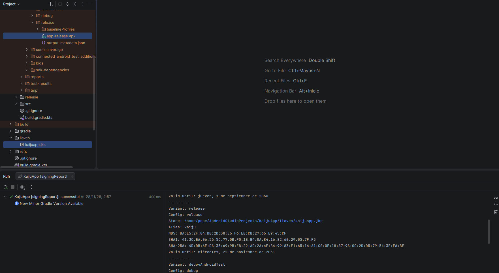

# KaijuApp — Grupo Vio Coders

Aplicación Android de **gestión y trazabilidad de inventario** para Kaiju (DSY1105, Duoc UC 2026-2).

## Integrantes participantes

| Nombre completo | Correo |
| --- | --- |
| José Valentín Calderón González | rjvc97@hotmail.com y jv.calderon@duocuc.cl |
| Sebastian Andres Apablaza Perez | se.apablazap@duocuc.cl |
| Sebastian Moises Navarro Gonzales | seba.navarrozales@gmail.com |

**Caso:** Kaiju desarrolla actividades vinculadas al comercio, los servicios y la gestión de productos. Su necesidad principal es mejorar el control y la trazabilidad del inventario. La solución es un MVP de una aplicación móvil de control de inventario con perfiles, conectada a un backend de usuarios y preparada para integrarse con servicios externos.

**Arquitectura:** Kotlin + Jetpack Compose, patrón MVVM (Screens → ViewModel → Repository → Room / Retrofit).

| Repositorio | Contenido |
| --- | --- |
| [pepestack/KaijuApp](https://github.com/pepestack/KaijuApp) | Esta app Android, el APK firmado y la llave de práctica |
| [pepestack/Sonido-Vivo-Backend](https://github.com/pepestack/Sonido-Vivo-Backend) | Backend de usuarios (Node.js + Express + PostgreSQL), compartido con Full Stack II |
| [Sebastiana-pablaza/Easter-egg-KaijuApp](https://github.com/Sebastiana-pablaza/Easter-egg-KaijuApp/tree/main) | Backend Spring Boot que consume la API externa (Divine Pride) |

## Funcionalidades implementadas

| Requerimiento | Funcionalidad |
| --- | --- |
| RF-01 | Inicio de sesión con correo y contraseña contra el backend de usuarios. La app reconoce el perfil y muestra solo lo que le corresponde. Un usuario inexistente o una contraseña incorrecta se rechazan. |
| RF-02 | Catálogo con nombre, categoría, precio y cantidad disponible. |
| RF-03 | Búsqueda por nombre o código y filtrado por categoría. |
| RF-04 | Detalle de productos con historial de movimientos, del más reciente al más antiguo. |
| RF-05 | Creación y edición de productos mediante un formulario validado. |
| RF-06 | Registro de entradas de mercadería. |
| RF-07 | Registro de salidas por venta o consumo, según el perfil. |
| RF-08 | Ajustes de inventario con motivo obligatorio. |
| RF-09 | Identificación de productos con stock bajo y pantalla de alertas. |
| RF-10 | Persistencia local de productos y movimientos al cerrar y volver a abrir la aplicación. |
| CRUD de usuarios | El Administrador lista, crea, edita y elimina usuarios desde la app. Los cambios se guardan en el backend. |
| API externa | Easter egg de Ragnarok Online: muestra un monstruo aleatorio obtenido desde una API externa (ver más abajo). |

También se implementan cierre de sesión, lectura de códigos de barras, notificaciones de stock bajo y animaciones de resultado al registrar movimientos.

### Perfiles disponibles

- **Administrador:** gestiona usuarios, crea y edita productos, registra movimientos y revisa el catálogo, el detalle y las alertas.
- **Encargado de inventario:** registra entradas, salidas y ajustes, y revisa el catálogo, el detalle y las alertas.
- **Vendedor:** consulta el catálogo y el detalle, y registra salidas por venta. No ve la gestión de usuarios ni el formulario de producto.

### Validaciones principales

- Código de producto obligatorio y único (RN-03).
- Nombre de al menos 3 caracteres y categoría obligatoria.
- Precio mayor que cero y stock mínimo no negativo (RN-02).
- Una salida nunca puede dejar el stock bajo cero (RN-01).
- Motivo obligatorio al registrar un ajuste (RN-04).
- Los movimientos no se editan ni se borran: un error se corrige con un ajuste (RN-05).
- Un producto entra en alerta cuando su stock es igual o menor a su stock mínimo (RN-06).
- Validación del código de barras (UPC-A o EAN-13) cuando se ingresa.
- Restricción de operaciones según el perfil activo.

En un ajuste, la cantidad ingresada corresponde al stock final contado.

## Endpoints utilizados

### Backend de usuarios ([Sonido-Vivo-Backend](https://github.com/pepestack/Sonido-Vivo-Backend))

URL base: la que se define en `local.properties` (ver *Cómo ejecutar*). Por defecto `http://10.0.2.2:3000/` (el backend local visto desde el emulador).

| Método | Endpoint | Uso en la app |
| --- | --- | --- |
| `POST` | `/api/v1/kaiju/auth/login` | Inicio de sesión (RF-01). Devuelve el `accessToken` JWT y el usuario con su rol. |
| `GET` | `/api/v1/kaiju/usuarios` | Listar usuarios en la gestión de usuarios. |
| `POST` | `/api/v1/kaiju/usuarios` | Crear un usuario. |
| `PUT` | `/api/v1/kaiju/usuarios/{id}` | Editar un usuario (si no se envía contraseña, se mantiene la actual). |
| `DELETE` | `/api/v1/kaiju/usuarios/{id}` | Eliminar un usuario (borrado lógico: el backend lo desactiva). |

Las rutas de `/usuarios` exigen el encabezado `Authorization: Bearer <token>` de un usuario Administrador. En la app viven en `data/remote/UsuarioApi.kt` y se consumen desde `repository/UsuarioRepository.kt`.

### API externa (easter egg)

| Método | Endpoint | Uso en la app |
| --- | --- | --- |
| `GET` | `https://apisnecoarc.duckdns.org/api/monster/random` | Monstruo aleatorio de Ragnarok Online (datos de Divine Pride). |

En la app vive en `data/remote/MonsterApi.kt` y se consume desde `repository/MonsterRepository.kt`. Es independiente del backend de usuarios: no lee ni modifica productos, movimientos ni usuarios.

## Dónde se guarda cada dato

| Dato | Dónde vive |
| --- | --- |
| Usuarios y su perfil | Backend de usuarios (PostgreSQL). Room guarda una copia de id, nombre y rol solo para mostrar quién hizo cada movimiento. |
| Productos y movimientos | En el teléfono, con Room (SQLite). |
| Monstruo de la API externa | No se guarda: solo se muestra mientras se está en la pantalla de movimientos. |

## Cómo ejecutar el proyecto

### 1. Levantar el backend de usuarios

Seguir las instrucciones del README de [Sonido-Vivo-Backend](https://github.com/pepestack/Sonido-Vivo-Backend) (Node.js, npm y PostgreSQL; `npm install`, configurar `.env`, `npm run db:seed` y `npm run dev`). El backend queda en `http://localhost:3000`. Las cuentas de prueba de KaijuApp (Administrador, Encargado de inventario y Vendedor) están en la sección **KaijuApp (DSY1105)** de ese README.

### 2. Abrir y ejecutar la app

1. Clonar o descargar este repositorio.
2. Abrir la carpeta raíz del proyecto en Android Studio.
3. Esperar la sincronización de Gradle y la descarga de las dependencias.
4. Instalar los componentes del SDK que solicite Android Studio.
5. **Si se usa el emulador**, no hay que configurar nada: la app busca el backend en `http://10.0.2.2:3000/`.
   **Si se usa un teléfono físico**, agregar en `local.properties` la IP del computador donde corre el backend (en la misma red Wi-Fi):
   ```properties
   kaiju.api.url=http://192.168.X.X:3000/
   ```
6. Seleccionar el módulo `app` y presionar **Run**.
7. Iniciar sesión con una de las cuentas de prueba del backend.

Se necesita Android 7.0 (API 24) o superior. Para probar el escáner se recomienda un teléfono con cámara y Google Play services.

## Recursos nativos del dispositivo

| Necesidad del caso | Recurso utilizado | Permisos | Relación con los requerimientos | Alternativa o comportamiento |
| --- | --- | --- | --- | --- |
| Avisar al administrador y al encargado cuando un producto pasa a tener stock bajo. | Notificaciones del sistema mediante NotificationCompat y un canal de notificaciones. | POST_NOTIFICATIONS en Android 13 o superior. | Complementa RF-09. | Si las notificaciones están desactivadas, las alertas siguen disponibles dentro de la aplicación. El permiso puede habilitarse desde los ajustes de Android. |
| Agilizar la identificación de productos y el ingreso de códigos de barras. | Cámara mediante Google Code Scanner, compatible con EAN-13 y UPC-A. | La aplicación no solicita permiso CAMERA: Google Play services administra la interfaz de captura. | Complementa la gestión de productos y el registro de movimientos de RF-05 a RF-08. | El ingreso y la selección manual siguen disponibles. Cancelar el escaneo permite continuar sin modificar los datos. |

Para utilizar el escáner se requiere un dispositivo compatible con Google Play services. La primera utilización puede requerir conexión a Internet para descargar el módulo de escaneo.

## Persistencia local

Los productos y movimientos se almacenan en una base de datos SQLite administrada mediante Room.

- Los datos de prueba se cargan al crear la base de datos por primera vez.
- Los cambios se conservan al cerrar y volver a abrir la aplicación.
- Las operaciones que modifican existencias y registran movimientos utilizan transacciones para mantener la consistencia.

Desinstalar la aplicación o borrar sus datos elimina la información almacenada localmente.

## Pruebas

### Pruebas de código (unitarias)

Están en `app/src/test` y usan **Kotest**, **MockK** (dobles del Repository y del aviso de stock) y **kotlinx-coroutines-test**. No necesitan emulador ni internet.

| Archivo | Prueba | Qué comprueba |
| --- | --- | --- |
| `InventarioViewModelSpec` | RN-01 | Una salida mayor al stock disponible se rechaza y no se guarda nada. |
| `InventarioViewModelSpec` | RN-04 | Un ajuste sin motivo se rechaza. |
| `InventarioViewModelSpec` | RF-07 | El vendedor solo puede registrar salidas por venta. |
| `InventarioViewModelSpec` | RN-02 y RN-03 | Un producto con código repetido y precio cero se rechaza. |
| `InventarioViewModelSpec` | RF-06 | Una entrada válida suma al stock y llega al Repository una sola vez. |
| `InventarioViewModelSpec` | RN-06 | Una salida que deja el stock en el mínimo o bajo él avisa una vez. |
| `CodigoBarrasSpec` | Normalización | Un UPC-A de 12 dígitos se guarda como EAN-13. |
| `CodigoBarrasSpec` | Dígito verificador | Un código con el dígito verificador incorrecto se rechaza. |

Para ejecutarlas: panel **Gradle → app → Tasks → verification → testDebugUnitTest**, o clic derecho sobre `cl.kaiju.kaijuapp (test)` → **Run**.

### Pruebas de emulación (instrumentadas)

Están en `app/src/androidTest` y se ejecutan en un emulador o teléfono conectado.

| Archivo | Qué comprueba |
| --- | --- |
| `TarjetaProductoTest` | La tarjeta de un producto con stock bajo muestra su nombre, la cantidad y la marca "Stock bajo", y responde al toque (RF-02, RF-04, RF-09). |

Para ejecutarlas: conectar el dispositivo y hacer clic derecho sobre `cl.kaiju.kaijuapp (androidTest)` → **Run**.

## APK firmado

La versión release se firma con la llave en `llaves/kaijuapp.jks` (alias `kaiju`). La llave se encuentra en el repositorio por petición del encargo, pero en un proyecto real no debería incluirse (si se quisiera publicar en Google Play, hay que cambiar esta llave). Las contraseñas **no** se guardan en el repositorio, viven en el `keystore.properties` local (porque está en .gitignore).

- APK firmado: [KaijuApp-v1.0.apk](https://github.com/pepestack/KaijuApp/releases/latest/download/KaijuApp-v1.0.apk)
- Llave de práctica: [`llaves/kaijuapp.jks`](llaves/kaijuapp.jks)
- 


### Cómo generar una copia firmada

La app compila y es editable sin estos pasos, pero serán builds debug con firmas locales, no se podrá generar el APK o AAB release firmado a menos de que sigan estos pasos:

1. Copiar `keystore.properties.example` y sacar el `.example`, quedando solo como `keystore.properties`
2. Reemplazar los dos `CHANGE_ME` por la contraseña de la llave, que solo el equipo tiene, ojo con no dejar espacios.
3. Revisar la URL del backend: El APK queda con la variable `kaiju.api.url` de `local.properties` del computador que lo compila, si no esta eso la app apunta a `http://10.0.2.2:3000/`, que solo funciona en emulador.
4. **Compilar** en Android Studio, por la terminal o presionando `Ctrl` dos veces y escribir:
    - gradle assembleRelease
    - gradle bundleRelease
   > El primero es el APK firmado, el segundo el AAB, para Google Play

Resultando en estos archivos:

   | Archivo | Ubicación |                                                                                                                                                                                                  
   | --- | --- |                                                                                                                                                                                                            
   | APK firmado | `app/build/outputs/apk/release/app-release.apk` |                                                                                                                                                        
   | AAB firmado | `app/build/outputs/bundle/release/app-release.aab` |

- Si aparece como `app-release-unsigned.apk`, Gradle no encontró `keystore.properties`: revise que esté en la raíz y que las contraseñas sean correctas.

## Diseño y planificación

Sketch, wireframe, mockup y demás material de diseño del equipo:
👉 [Carpeta de Drive del equipo](https://drive.google.com/drive/folders/1WHd4rQCI52z48mTNynwqBaFVcs_YqF-e?usp=sharing)

Planificación del equipo en [Trello](https://trello.com/b/o9dSc8Fp/kaijuapp).

# Integración de API REST externa — Easter Egg de Ragnarok Online

## 1. Descripción de la funcionalidad

Como parte de la actividad EA3 3.1, el equipo decidió desarrollar la **Opción B: integración de una API a elección**.

Para ello, se incorporó a Kaiju una funcionalidad complementaria (*Easter Egg*) relacionada con el videojuego Ragnarok Online.

El objetivo es que, al ingresar una combinación específica de datos, el usuario vea la información de un monstruo seleccionado aleatoriamente, obtenida desde una API externa.

La información que se muestra incluye:

- ID del monstruo.
- Nombre.
- Nivel.
- Raza.
- Elemento.
- Puntos de vida.
- Imagen del monstruo en formato PNG.

Para implementar esta funcionalidad, se desarrolló un backend propio utilizando Spring Boot, alojado en una instancia de AWS EC2 con Ubuntu.
Más información respecto al backend en el siguiente repositorio -> https://github.com/Sebastiana-pablaza/Easter-egg-KaijuApp/tree/main

## Cómo activarlo

Al registrar correctamente un movimiento de **ENTRADA de 67 unidades**, aparece una tarjeta debajo de **Registrar movimiento**, dentro de la misma pantalla. Muestra imagen, nombre, ID, nivel, raza, elemento y vida del monstruo recibido.

La tarjeta permanece sin temporizador mientras se esté en Movimientos. Otra entrada confirmada de 67 solicita un monstruo aleatorio y reemplaza la ficha al recibirlo; el servidor puede devolver el mismo monstruo. Las activaciones durante una consulta pendiente se ignoran para evitar solicitudes simultáneas.

Cambiar de pestaña, volver atrás o cerrar sesión limpia la tarjeta y cancela la consulta pendiente. Al regresar no se muestra una ficha anterior. Rotar el celular conserva el estado sin repetir la consulta. Minimizar la app no equivale a salir de Movimientos; el estado vive en el ViewModel y no persiste tras terminar el proceso.

- API: backend propio Spring Boot en AWS, que consulta Divine Pride.
- URL base: https://apisnecoarc.duckdns.org/
- Endpoint: GET api/monster/random (sin parámetros).
- Android utiliza Retrofit/Gson para el JSON y Coil para spriteUrl.
- La clave de Divine Pride permanece exclusivamente en AWS.
- Flujo: movimiento confirmado -> EventoUi -> AppNavHost -> MonsterViewModel ->
  MonsterRepository -> MonsterApi -> estado observable -> PantallaMovimiento -> TarjetaMonstruo.
- La consulta se dispara solo después de guardar correctamente. Escribir 67, crear un producto con stock inicial 67, guardar otras cantidades, las salidas y los ajustes no activan ni retiran una ficha existente.
- Un fallo del easter egg no modifica ni revierte el movimiento guardado. Reintentar consulta la API sin registrar stock. Si había una ficha previa, se conserva con el aviso.
- Si falla solo la imagen, los atributos permanecen visibles y Reintentar imagen reutiliza el JSON sin consultar nuevamente el endpoint de monstruos.

## Pruebas de funcionamiento

| Prueba | Resultado |
|---|---|
| Consulta del Poring mediante Postman | Exitosa, HTTP 200 |
| Consulta aleatoria mediante Postman | Exitosa, HTTP 200 |
| Consulta mediante HTTPS | Exitosa, HTTP 200 |
| Ruta inexistente `/api/monster/999999` | HTTP 404 |
| Parámetro desconocido `apiKey=PRUEBA` | No alteró la respuesta normal |
| Manejo de errores 429 simulados | Pendiente de verificar |
| Entrada inválida desde Android | Pendiente |
| Falla de conexión y reintento desde Android | Pendiente |

La prueba de una ruta inexistente comprueba la respuesta HTTP 404, pero no sustituye por sí sola la validación de una entrada inválida dentro de la aplicación Android.

## Conclusión

Con esta implementación se integró un servicio externo de datos mediante una arquitectura que combina Android, Spring Boot y AWS.

La utilización de DuckDNS permitió mantener una dirección de acceso estable, mientras que Caddy permitió incorporar HTTPS.

El backend propio permitió proteger la API key de Divine Pride, controlar las solicitudes y transformar las respuestas externas en información más sencilla para la aplicación móvil.

Esta funcionalidad complementa el proyecto Kaiju sin modificar las responsabilidades principales del sistema de inventario.
